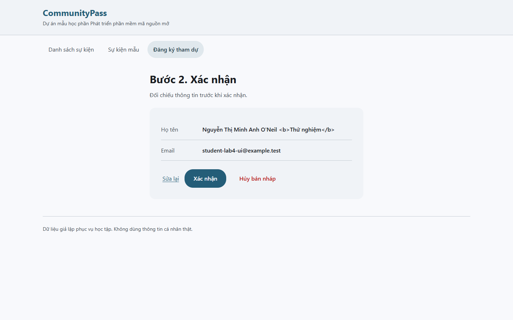
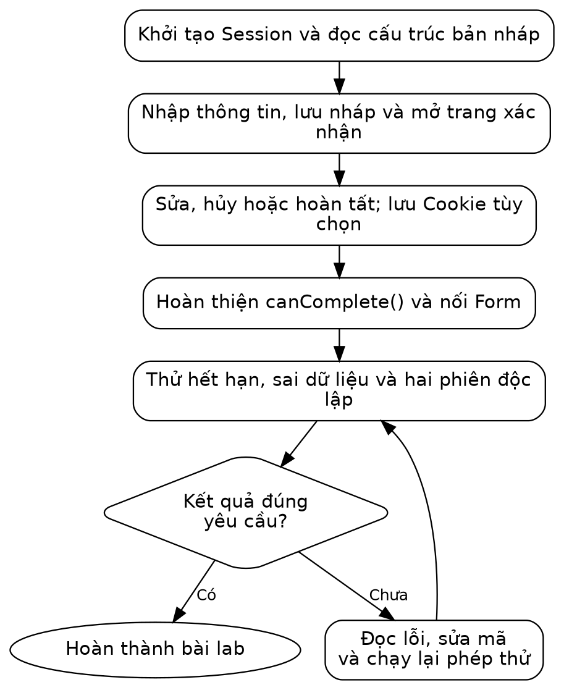

# LAB 04 — QUẢN LÝ BẢN NHÁP BẰNG SESSION VÀ COOKIE

Học phần: Phát triển phần mềm mã nguồn mở. Đối tượng: sinh viên năm 3, chuyên ngành Phát triển phần mềm. Bài thực hành sử dụng mã nguồn CommunityPass được cấp trong thư mục Ma\_nguon.

## I. MỤC TIÊU VÀ CHUẨN BỊ

Nội dung bài giảng: Chương 3, slide 23–31: Session, Cookie, khởi tạo, đọc, cập nhật và xóa. Số trang tính cả trang bìa. Git và kiểm thử được sử dụng để hỗ trợ thực hành.

Sau khi hoàn thành bài thực hành, sinh viên có khả năng:

- Phân biệt dữ liệu Session ở phía máy chủ và tùy chọn Cookie phía trình duyệt.
- Xây luồng nhập, xác nhận, sửa, hủy và hoàn tất mô phỏng.
- Kiểm tra nháp vắng mặt, hết hạn và hai phiên độc lập.
- Hoàn thiện kiểm tra bản nháp, thời hạn và các thao tác sửa, hủy, xác nhận trong một phiên sử dụng.

Chuẩn bị: đọc nội dung bài giảng được nêu trên, giải nén trọn thư mục của lab và mở Ma\_nguon trong trình soạn thảo. Bài đã có đủ mã và dữ liệu khởi đầu; chỉ sửa những tệp được chỉ rõ trong phần hướng dẫn và bài tự làm.

### Công cụ cần có

Sử dụng terminal Ubuntu hoặc Ubuntu trong WSL, PHP từ 8.1 và Git. Nếu máy đã có đủ công cụ, chỉ cần kiểm tra phiên bản. Trên máy được phép cài phần mềm, thực hiện:

```bash
sudo apt update
sudo apt install php-cli git unzip
php -v
git --version
```

Các lệnh Bash chạy trong terminal Ubuntu, không chạy trong PowerShell. Bài này không cần cơ sở dữ liệu hoặc framework.

### Bối cảnh và nội dung thực hành

Khi đăng ký sự kiện, người dùng cần xem lại thông tin trước khi xác nhận và có thể quay lại để chỉnh sửa. Dữ liệu trong biến PHP của yêu cầu trước không tự được giữ cho yêu cầu tiếp theo. Bài này sử dụng Session để lưu bản nháp trên máy chủ và Cookie để ghi nhớ tùy chọn hiển thị.

Bước hoàn tất trong bài chỉ ghi nhận kết quả mô phỏng trong Session; chưa lưu đăng ký vào cơ sở dữ liệu hoặc phát hành vé. Phần lưu CSDL không thuộc phạm vi bài thực hành Session này.



*Màn hình xác nhận của mã mẫu*

## II. QUY TRÌNH THỰC HÀNH



*Sơ đồ hướng thực hiện Lab 04*

Sơ đồ thể hiện thứ tự thực hiện và các bước kiểm tra. Tại nút quyết định hình thoi, đối chiếu kết quả với yêu cầu; nếu chưa đạt, quay lại bước xử lý tương ứng trước khi tiếp tục.

Mở thư mục Lab04/Ma\_nguon bằng trình soạn thảo và mở terminal Ubuntu tại thư mục này. Chạy pwd và ls để kiểm tra vị trí; danh sách tệp cần có lab.sh. Các đường dẫn trong bài được tính từ Ma\_nguon. Trên Windows, thực hiện lệnh Bash trong Ubuntu/WSL.

```bash
bash lab.sh check
bash lab.sh run
```

Kết quả chạy: mở http://127.0.0.1:8104. Giữ terminal máy chủ mở, dùng terminal thứ hai tại cùng thư mục để sửa/chạy test. Dừng bằng Ctrl+C; không mở hai máy chủ cùng cổng.

Kiểm tra trước khi thực hành:

- [ ] Lệnh check xác nhận đủ công cụ để chạy bài thực hành.
- [ ] Chạy được chương trình mẫu và xác định được thư mục chứa mã nguồn.
- [ ] Phân biệt lệnh test dùng cho bài mẫu và lệnh extend dùng cho bài tập mở rộng.

## III. TỔ CHỨC DỮ LIỆU

Thư mục Lab04/Ma\_nguon đã có mã mẫu cho phần hướng dẫn. Chạy mẫu trước để xem kết quả, sau đó đọc và thực hiện lại các bước ở phần IV trên chính các tệp đó. Khi bài yêu cầu thay toàn bộ nội dung, không chép nối thêm một hàm hoặc lớp trùng tên. Phần mở rộng để sinh viên tự hoàn thiện ở mục VI.

| **Phần thực hành** | **Tệp và công việc** | **Kết quả cần đạt** |
| --- | --- | --- |
| Mẫu có hướng dẫn | src/Draft.php; src/Session.php; public/register.php; public/confirm.php; public/complete.php<br>Đọc và thực hiện lại luồng nhập, lưu nháp, xác nhận, sửa và hủy. Phân biệt dữ liệu Session với Cookie tùy chọn. | Hoàn tất hợp lệ có SIMULATED\_OK; hủy xóa nháp. bash lab.sh test: TESTS=6 FAILED=0. Chưa ghi CSDL. |
| Bài tự mở rộng | src/DraftGuard.php; public/confirm.php; public/complete.php<br>Viết canComplete, rồi nối vào bước hoàn tất. Kiểm tra sự kiện, thời điểm tạo, thời hạn và dữ liệu bản nháp. | bash lab.sh extend: TESTS=7 FAILED=0. Đúng mốc hết hạn phải từ chối; xác nhận hợp lệ vẫn chạy sau khi tích hợp. |

Vai trò từng tệp trong bài mẫu:

| **Thành phần** | **Vai trò** |
| --- | --- |
| src/Session.php | Đã cấp. Khởi tạo phiên, Cookie phiên và token bảo vệ form. |
| src/Draft.php | Bạn đọc và sửa. Hàm lưu, kiểm tra tuổi và xóa bản nháp. |
| public/register.php | Bạn đọc và sửa. Nhận form, lưu nháp, chuyển trang. |
| public/confirm.php | Bạn đọc và sửa. Đọc nháp để xem lại, sửa hoặc hủy. |
| public/complete.php | Bạn đọc và sửa. Kết thúc mô phỏng, xóa nháp rồi chuyển sang trang kết quả. |
| public/cancel.php | Bạn đọc và sửa. Xử lý nút hủy bằng POST. |
| public/preferences.php | Bạn đọc và sửa. Lưu tùy chọn xem vào Cookie. |

Session của mẫu lưu draft gồm data (thông tin đăng ký) và created\_at (thời điểm tạo). Cookie view chỉ có giá trị compact hoặc full. Không lưu họ tên, email, mật khẩu hoặc quyền quản trị trong Cookie tùy chọn.

## IV. HƯỚNG DẪN THỰC HÀNH

### Bước 1. Đọc tệp khởi tạo phiên đã cấp

Mở src/Session.php. Tệp gọi session\_start() trước khi gửi HTML. Sau đó PHP đọc hoặc ghi dữ liệu bằng $\_SESSION. Trình duyệt nhận Cookie chứa định danh phiên; dữ liệu bản nháp nằm phía máy chủ \[PHP-SESSION\].

Tệp đã có hàm checkCsrf và trường csrf ẩn trong Form. Giữ các thành phần này khi sửa bài: chúng đối chiếu token của yêu cầu với token trong phiên. Giảng viên giới thiệu cơ chế hoạt động; bài chưa yêu cầu xây dựng chức năng đăng nhập.

Kiểm tra kết quả bước 1:

- [ ] Session được mở trước HTML; phần token đã cấp được giữ nguyên.

### Bước 2. Tạo các hàm quản lý bản nháp

Mở src/Draft.php và đối chiếu với mã dưới đây. Nếu viết lại tệp, thay nội dung hiện tại; tránh khai báo trùng hàm hoặc lớp:

```php
<?php
declare(strict_types=1);
function saveDraft(array &$session, array $data, int $now): void {
    $session['draft'] = ['data'=>$data, 'created_at'=>$now];
    unset($session['completed']);
}
function draftExpired(array $session, int $now, int $ttl): bool {
    if (!isset($session['draft'])) { return true; }
    return $now - $session['draft']['created_at'] >= $ttl;
}
function cancelDraft(array &$session): void { unset($session['draft']); }
```

&amp;$session nhận tham chiếu để thay đổi mảng ở nơi gọi; khi truyền $\_SESSION, thay đổi được giữ trong phiên. Hàm saveDraft lưu dữ liệu và thời điểm tạo, đồng thời xóa kết quả hoàn tất cũ. unset chỉ xóa khóa được chỉ định, không xóa mọi dữ liệu của phiên.

$now - created\_at là tuổi bản nháp tính bằng giây. Bản nháp hết hạn khi tuổi lớn hơn hoặc bằng $ttl. Nhận $now qua tham số giúp kiểm thử thời gian giả lập mà không phải chờ thật 30 phút.

Mẫu dùng dữ liệu bản nháp do chính ứng dụng tạo nên hàm kiểm tra còn đơn giản. Phần tự làm sẽ xử lý dữ liệu thiếu, sai sự kiện và thời điểm không hợp lệ.

Kiểm tra kết quả bước 2:

- [ ] Nháp gồm data/created\_at; lưu nháp mới xóa kết quả hoàn tất cũ.

### Bước 3. Tạo trang nhập và lưu nháp

Mở public/register.php:

```php
<?php
require __DIR__.'/../src/Session.php';
require __DIR__.'/../src/Input.php';
require __DIR__.'/../src/Draft.php';
$events = require __DIR__.'/../data/events.php';
$errors = [];
$data = $_SESSION['draft']['data'] ?? ['event_id'=>1,'name'=>'','email'=>''];
if ($_SERVER['REQUEST_METHOD'] === 'POST') {
    checkCsrf($_POST);
    $result = validateRegistration($_POST, $events);
    $errors = $result['errors']; $data = $result['data'];
    if (!$errors) {
        saveDraft($_SESSION, $data, time());
        header('Location: /confirm.php', true, 303); exit;
    }
}
require __DIR__.'/../templates/header.php';
?>
<div class="page-heading">
<h1>Bước 1. Nhập thông tin</h1>
<p>Điền thông tin để chuyển đến bước xem lại bản nháp.</p>
</div>
<div class="error-summary" role="alert">
<p class="error-messages"><?= e(implode(', ', $errors)) ?></p>
<p>Thông tin chưa hợp lệ. Kiểm tra lại các thông tin đã nhập rồi gửi lại.</p>
</div>
<form class="registration-form" method="post">
<input type="hidden" name="csrf" value="<?= e($_SESSION['csrf']) ?>">
<label class="form-field" for="event_id">Sự kiện
<select id="event_id" name="event_id">
<?php foreach($events as $event): ?>
<option value="<?= $event['id'] ?>" <?= (int)$data['event_id']===$event['id']?'selected':'' ?>>
<?= e($event['title']) ?>
</option>
<?php endforeach; ?>
</select>
</label>
<label class="form-field" for="name">Họ tên
<input id="name" name="name" value="<?= e($data['name']) ?>">
</label>
<label class="form-field" for="email">Email
<input id="email" name="email" value="<?= e($data['email']) ?>">
</label>
<button>Tiếp tục</button>
</form>
<form class="preferences-form" method="post" action="/preferences.php">
<h2>Tùy chọn hiển thị</h2>
<p>Form này chỉ lưu tùy chọn Cookie, không gửi đăng ký.</p>
<input type="hidden" name="csrf" value="<?= e($_SESSION['csrf']) ?>">
<label class="form-field" for="view">Cách hiển thị
<select id="view" name="view">
<option value="compact">Gọn</option>
<option value="full">Đầy đủ</option>
</select>
</label>
<button class="button-secondary">Lưu tùy chọn</button>
</form>
<p class="cookie-status">Tùy chọn Cookie: <?= e(field($_COOKIE, 'view')) ?>
</p>
<?php require __DIR__.'/../templates/footer.php'; ?>
```

Đọc phần PHP đầu tệp: nếu đã có nháp thì lấy dữ liệu điền lại form; nếu chưa có thì dùng giá trị rỗng. Khi POST, kiểm tra token trước, sau đó dùng hàm kiểm tra dữ liệu trong src/Input.php được cấp. Chỉ khi không có lỗi mới gọi saveDraft.

header('Location: /confirm.php', true, 303) yêu cầu trình duyệt chuyển sang GET trang xác nhận. exit ngăn chương trình tiếp tục xuất HTML sau khi đã chuyển hướng. Không đặt dòng echo hoặc HTML trước phần xử lý này.

Form sử dụng trường ẩn csrf; giá trị lấy từ Session. Form nhỏ thứ hai chỉ lưu tùy chọn hiển thị, không gửi đăng ký. Trang nhận dữ liệu của form này được xây dựng ở bước 7.

Kiểm tra kết quả bước 3:

- [ ] Nhập hợp lệ chuyển đến xác nhận; quay lại sửa thấy đúng dữ liệu nháp.

### Bước 4. Tạo trang xác nhận

Mở public/confirm.php:

```php
<?php
require __DIR__.'/../src/Session.php';
require __DIR__.'/../src/Input.php';
require __DIR__.'/../src/Draft.php';
if (draftExpired($_SESSION, time(), 1800)) {
    cancelDraft($_SESSION);
    header('Location: /register.php', true, 303); exit;
}
$data = $_SESSION['draft']['data'];
require __DIR__.'/../templates/header.php';
?>
<div class="page-heading">
<h1>Bước 2. Xác nhận</h1>
<p>Đối chiếu thông tin trước khi xác nhận.</p>
</div>
<section class="confirmation" aria-label="Thông tin đăng ký">
<dl class="summary-list">
<div>
<dt>Họ tên</dt>
<dd><?= e($data['name']) ?></dd>
</div>
<div>
<dt>Email</dt>
<dd><?= e($data['email']) ?></dd>
</div>
</dl>
<div class="confirmation-actions">
<a href="/register.php">Sửa lại</a>
<form method="post" action="/complete.php">
<input type="hidden" name="csrf" value="<?= e($_SESSION['csrf']) ?>">
<button>Xác nhận</button>
</form>
<form method="post" action="/cancel.php">
<input type="hidden" name="csrf" value="<?= e($_SESSION['csrf']) ?>">
<button class="button-secondary button-cancel">Hủy bản nháp</button>
</form>
</div>
</section>
<?php require __DIR__.'/../templates/footer.php'; ?>
```

Nếu chưa có nháp hoặc nháp đã hết 1.800 giây, trang đưa người dùng về form. Nhờ đó không thể gõ thẳng URL xác nhận khi chưa nhập thông tin. Với nháp còn hiệu lực, trang chỉ đọc và hiển thị.

Nút Sửa lại là liên kết GET vì chỉ mở form. Hai nút Xác nhận và Hủy là form POST vì làm thay đổi trạng thái. Không bỏ e khi hiển thị họ tên hoặc email đã lưu.

Kiểm tra kết quả bước 4:

- [ ] Không có nháp hoặc nháp hết hạn thì quay về nhập, không xác nhận được.

### Bước 5. Tạo bước hoàn tất mô phỏng

Mở public/complete.php:

```php
<?php
require __DIR__.'/../src/Session.php';
require __DIR__.'/../src/Input.php';
require __DIR__.'/../src/Draft.php';
if ($_SERVER['REQUEST_METHOD'] === 'POST') {
    checkCsrf($_POST);
    if (draftExpired($_SESSION, time(), 1800)) {
        cancelDraft($_SESSION);
        header('Location: /register.php', true, 303); exit;
    }
    $_SESSION['completed'] = 'SIMULATED_OK';
    cancelDraft($_SESSION);
    header('Location: /complete.php', true, 303); exit;
}
if (!isset($_SESSION['completed'])) {
    header('Location: /register.php', true, 303); exit;
}
require __DIR__.'/../templates/header.php';
?>
<div class="page-heading">
<h1>Bước 3. Hoàn tất mô phỏng</h1>
</div>
<section class="completion" role="status">
<p class="status-message">
<?= e($_SESSION['completed']) ?>
</p>
<p>Chưa ghi vào CSDL; đây không phải vé hoặc bằng chứng đăng ký thật.</p>
</section>
<?php require __DIR__.'/../templates/footer.php'; ?>
```

POST hợp lệ tạo dấu SIMULATED\_OK trong Session, xóa bản nháp, rồi chuyển sang GET cùng trang. Làm mới trang kết quả sẽ không gửi lại POST. Nếu gõ trực tiếp URL mà chưa hoàn tất, mẫu đưa về form.

Đây là luồng POST → chuyển hướng → GET. Nó giúp tránh một số hành vi gửi lại form do tải lại trang; không được coi là cơ chế bảo đảm mọi thao tác ghi dữ liệu không bao giờ lặp. Khi có thao tác ghi CSDL, cần kiểm tra thêm ràng buộc dữ liệu.

Kiểm tra kết quả bước 5:

- [ ] Hoàn tất mô phỏng cho kết quả trong phiên; hiểu rằng chưa tạo hàng CSDL.

### Bước 6. Tạo xử lý hủy

Mở public/cancel.php:

```php
<?php
require __DIR__.'/../src/Session.php';
require __DIR__.'/../src/Draft.php';
if ($_SERVER['REQUEST_METHOD'] !== 'POST') { http_response_code(405); exit('POST_REQUIRED'); }
checkCsrf($_POST);
cancelDraft($_SESSION);
header('Location: /register.php', true, 303); exit;
```

Mã chỉ nhận POST, kiểm tra token rồi xóa khóa bản nháp. Không gọi session\_destroy() vì ta không muốn xóa token và mọi trạng thái khác của phiên chỉ để hủy một form.

Kiểm tra kết quả bước 6:

- [ ] Hủy xóa nháp và quay lại nhập; không xóa toàn bộ dữ liệu phiên.

### Bước 7. Ghi và đọc Cookie tùy chọn

Mở public/preferences.php:

```php
<?php
require __DIR__.'/../src/Session.php';
if ($_SERVER['REQUEST_METHOD'] !== 'POST') { http_response_code(405); exit('POST_REQUIRED'); }
checkCsrf($_POST);
$view = $_POST['view'] ?? '';
if (!is_string($view) || !in_array($view, ['compact', 'full'], true)) {
    http_response_code(422); exit('VIEW_INVALID');
}
setcookie('view', $view, ['expires'=>time()+3600, 'path'=>'/', 'httponly'=>true,
    'samesite'=>'Lax', 'secure'=>isset($_SERVER['HTTPS']) && $_SERVER['HTTPS'] !== 'off']);
header('Location: /register.php', true, 303); exit;
```

Cookie tồn tại một giờ và áp dụng cho đường dẫn /. Giá trị chỉ được chọn trong hai lựa chọn đã công bố. Sau setcookie, trình duyệt nhận Cookie rồi gửi lại trong request tiếp theo; việc chuyển hướng giúp trang form đọc được giá trị mới qua $\_COOKIE.

Trong giao diện mẫu, lựa chọn được hiển thị bằng dòng “Tùy chọn Cookie”; chưa thay toàn bộ cách bố trí giao diện. Các thuộc tính httponly, samesite và secure được cấp sẵn. secure bật khi chạy HTTPS; môi trường HTTP cục bộ không được đặt Secure cố định, nếu không trình duyệt sẽ không gửi Cookie đó qua HTTP.

Kiểm tra kết quả bước 7:

- [ ] Cookie chỉ chứa compact/full và đọc được ở request tiếp theo; không lưu thông tin nhạy cảm.

Kết quả sau phần hướng dẫn: Hoàn tất hợp lệ có SIMULATED\_OK; hủy xóa nháp. bash lab.sh test: TESTS=6 FAILED=0. Chưa ghi CSDL.

## V. LỖI THƯỜNG GẶP VÀ CÁCH KHẮC PHỤC

```bash
php tests/run.php
bash lab.sh run
```

Nếu máy chủ cũ còn chạy, dùng terminal thứ hai để chạy test hoặc dừng bằng Ctrl+C. Mở đúng địa chỉ của bài thực hành.

| **Phép thử** | **Kết quả cần thấy** |
| --- | --- |
| Nhập hợp lệ → Tiếp tục | Sang xác nhận, thông tin đúng. |
| Sửa lại → thay họ tên → Tiếp tục | Xác nhận dùng tên mới. |
| Hủy bản nháp | Trở về form; không giữ bản nháp vừa hủy. |
| Xác nhận → tải lại trang | Vẫn SIMULATED\_OK, không cần gửi lại form. |
| Mở xác nhận trong cửa sổ riêng tư mới | Bị đưa về form vì phiên mới chưa có nháp. |
| Lưu tùy chọn compact | Request tiếp theo hiển thị Cookie compact. |

Hai tab trong cùng trình duyệt thường dùng chung Cookie phiên; không dùng hai tab để chứng minh hai người dùng độc lập. Dùng cửa sổ riêng tư hoặc trình duyệt khác. Giữ token bảo vệ biểu mẫu và thông tin cá nhân trong môi trường thực hành.

| **Lỗi** | **Cách kiểm tra** |
| --- | --- |
| Headers already sent | Có khoảng trắng/BOM/HTML trước session\_start hoặc header không? |
| CSRF\_INVALID | Có giữ trường hidden csrf và dùng cùng phiên không? Tải lại form để nhận token hợp lệ, không tắt kiểm tra. |
| Sửa lại nhưng mất dữ liệu | Xem dữ liệu được lấy từ $\_SESSION\['draft'\]\['data'\] và truyền vào giá trị input chưa. |
| Cookie chưa có ngay sau khi ghi | Đọc ở request tiếp theo; giữ chuyển hướng sau setcookie. |

## VI. BÀI TẬP MỞ RỘNG: KIỂM TRA BẢN NHÁP TRƯỚC KHI HOÀN TẤT

```bash
# Vẫn đứng trong Ma_nguon của bài này.
bash lab.sh extend
```

Hoàn thiện hàm canComplete trong src/DraftGuard.php. Kiểm thử hàm trước, sau đó tích hợp vào trang hoàn tất theo hướng dẫn dưới đây.

Hàm nhận mảng Session, ID sự kiện đang yêu cầu, thời gian hiện tại và thời gian sống. Chỉ trả true khi có bản nháp hợp lệ, đúng sự kiện, chưa hết hạn, thời điểm tạo không ở tương lai và thời gian sống lớn hơn 0. Thời điểm đúng ngưỡng hết hạn phải trả false.

Chạy bash lab.sh extend để kiểm tra 7 ca mở rộng; chạy lại bash lab.sh test để kiểm tra chức năng cũ. Bộ kiểm thử sử dụng now=1300, created\_at=1000, ttl=300 cho trường hợp đúng ngưỡng hết hạn, nên không cần chờ thời gian thực.

### Nối hàm kiểm tra vào bước hoàn tất

Sau khi bash lab.sh extend đạt, mở public/confirm.php. Trong form action="/complete.php", ngay sau trường ẩn csrf, thêm trường ID sự kiện:

```php
<input type="hidden" name="event_id"
       value="<?= (int)$data['event_id'] ?>">
```

Không thêm trường này vào form hủy. Trình duyệt gửi ID để hàm đối chiếu với bản nháp phía máy chủ; trường ẩn không phải bằng chứng quyền truy cập. Nếu thiếu trường, hàm nhận ID 0 và từ chối ngay cả đăng ký hợp lệ.

Tiếp theo mở public/complete.php. Thêm ngay sau các dòng require:

```php
require __DIR__.'/../src/DraftGuard.php';
```

Trong nhánh POST, giữ checkCsrf($\_POST). Thay điều kiện kiểm tra bản nháp trước khi hoàn tất bằng điều kiện gọi hàm vừa viết:

```php
if (!canComplete($_SESSION, (int)field($_POST, 'event_id'), time(), 1800)) {
    cancelDraft($_SESSION);
    header('Location: /register.php', true, 303);
    exit;
}
```

Giữ nguyên phần hoàn tất mô phỏng phía sau. Gửi form xác nhận hợp lệ phải đến trang hoàn tất; yêu cầu sai sự kiện hoặc bản nháp hết hạn phải quay lại form. Thử bằng dữ liệu giả trên máy học tập.

## KẾT QUẢ CỦA BÀI THỰC HÀNH

Có luồng nhập, xem lại, sửa, hủy và hoàn tất mô phỏng; bản nháp sai hoặc hết hạn bị từ chối; các phiên sử dụng và tùy chọn giao diện tách biệt.

## VII. BẢNG KIỂM HOÀN THÀNH

- [ ] Tải lại trang xác nhận giữ đúng bản nháp còn hạn.
- [ ] Sửa và hủy không làm thay đổi phiên của người khác.
- [ ] Nháp hết hạn/sai sự kiện không hoàn tất được.
- [ ] Yêu cầu thiếu token bị từ chối; Cookie giữ đúng tùy chọn.
- [ ] test và extend đạt; luồng Web thực sự gọi kiểm tra bản nháp.

Kết quả tổng hợp của phần tự làm phải có TESTS=7 FAILED=0. Ngoài các phép thử tự động, thực hiện các tình huống kiểm tra trực tiếp nêu trong bài. Lệnh check chỉ xác nhận môi trường, không thay cho test và extend.

## VIII. RUBRIC LAB — 10 ĐIỂM

| **Tiêu chí** | **Điểm** | **Cách chấm** |
| --- | --- | --- |
| Phần mẫu có hướng dẫn | 2,0 | 1 điểm: thực hiện và có kết quả đúng; 1 điểm: giải thích luồng mã. Mỗi phần đạt một phần: 0,5; chưa đạt: 0. |
| Kiểm tra bản nháp | 1,5 | Từ chối nháp không tồn tại, hết hạn, sai sự kiện hoặc sai cấu trúc theo yêu cầu. |
| Tích hợp luồng xác nhận | 1,5 | Gọi phần kiểm tra trước khi hoàn tất; sửa/hủy giữ đúng trạng thái và không ảnh hưởng dữ liệu phiên khác. |
| Bảo vệ thao tác | 1,0 | Thao tác đổi dữ liệu dùng POST và token được cấp; Cookie tùy chọn không chứa dữ liệu đăng ký hoặc quyền. |
| Kiểm thử và xử lý lỗi | 2,0 | 1 điểm: có dữ liệu và kết quả mong đợi cho tình huống đúng, sai, biên; 1 điểm: chạy lại phần mẫu và mở rộng sau sửa. Mỗi phần đạt một phần: 0,5; chưa đạt: 0. |
| Mã nguồn và bàn giao | 1,0 | 0,5: nộp đúng tệp, dữ liệu và phiên bản; 0,5: README có lệnh chạy/kiểm thử, không chứa cấu hình riêng. Đạt một phần mỗi mục: 0,25. |
| Giải thích cá nhân | 1,0 | 0,5: giải thích phần tự viết; 0,5: giải thích một ca lỗi hoặc thực hiện một thay đổi nhỏ. Đạt một phần mỗi mục: 0,25. |
| Tổng | 10,0 | Chấm trực tiếp sản phẩm và phần giải thích của bài lab. |

Với tiêu chí 1,5 điểm: đủ yêu cầu được 1,5; thực hiện một phần được 0,75; chưa thực hiện được 0. Với tiêu chí 1 điểm không chia tiểu mục: đủ được 1; một phần được 0,5; chưa thực hiện được 0. Bài tự làm không đạt điểm chỉ nhờ thay bộ kiểm thử hoặc ghi sẵn kết quả.

## IX. NỘP BÀI

Bước 1. Lưu mã bài mẫu và bài tự làm tại Lab04/Ma\_nguon, kèm dữ liệu, kiểm thử và README. Loại bỏ .local, mật khẩu và dữ liệu cá nhân thật khỏi bài nộp.

Bước 2. Chạy bash lab.sh check, bash lab.sh test và bash lab.sh extend. Thực hiện các phép kiểm tra trực tiếp trong bài và sửa lỗi trước khi nộp.

Bước 3. Commit, đẩy mã lên GitHub và nộp tên nhóm/thành viên, Lab 04, liên kết Ma\_nguon tại đúng commit. Kiểm tra quyền đọc; kèm lần chạy Actions khi được yêu cầu. Hạn và địa chỉ nộp do giảng viên công bố. Nếu nhận ZIP, giữ nguyên cấu trúc trên.
