<h2 align="center">
    <a href="https://dainam.edu.vn/vi/khoa-cong-nghe-thong-tin">
    🎓 Faculty of Information Technology (DaiNam University)
    </a>
</h2>
<h2 align="center">
    Open Source Software Development
</h2>
<div align="center">
    <p align="center">
        
        
        
    </p>

[](https://www.facebook.com/DNUAIoTLab)
[](https://dainam.edu.vn/vi/khoa-cong-nghe-thong-tin)
[](https://dainam.edu.vn)

</div>

<h2 align="center">Nhóm 10 – CNTT 18-09</h2>
<h3 align="center">Xây dựng hệ thống quản lý kho, điều chuyển hàng và kiểm kê tại nhiều điểm</h3>

<p align="center">
    <a href="https://omnistock-bf5w.onrender.com"></a>
</p>

---

## Thành viên & phân công

**Giảng viên hướng dẫn:** ThS. Lê Tuấn Anh

| STT | Họ và tên | Mã sinh viên | Vai trò | Công việc chính |
|:---:|---|:---:|---|---|
| 1 | Nguyễn Đăng Quang | 1871020481 | Nhóm trưởng | Thiết kế CSDL và sổ phát sinh; nghiệp vụ phiếu nhập / xuất / điều chuyển; kiểm kê nhiều người; trợ lý AI; triển khai lên Render |
| 2 | Nguyễn Thị Tuyết | 1871020644 | Thành viên | Thiết kế giao diện (máy tính và điện thoại); danh mục kho, mặt hàng, lô hàng; nhập / xuất file Excel; viết tài liệu báo cáo |
| 3 | Đỗ Trung Kiên | 1871020344 | Thành viên | Tài khoản và phân quyền kho; yêu cầu điều chuyển; các trang báo cáo và thông báo; dữ liệu mẫu và kiểm thử |

---

## 1. Giới thiệu đề tài

### Bối cảnh
Doanh nghiệp bán lẻ, phân phối thường có **nhiều kho ở nhiều tỉnh thành**. Khi quản lý bằng sổ tay hoặc Excel riêng từng kho, rất dễ gặp các tình huống: số tồn trên giấy khác số thật, hàng chuyển giữa hai kho "biến mất" giữa đường, hai người cùng xuất một lô hàng, lô hết hạn nằm quên trong kho, kiểm kê xong không biết chênh lệch do đâu.

### Mục tiêu
**OmniStock** là ứng dụng web giúp quản lý **nhiều kho cùng lúc** trên một hệ thống:

- Theo dõi tồn kho **theo từng kho, từng mặt hàng, từng lô** (số lô, ngày sản xuất, hạn sử dụng).
- Mọi thay đổi tồn kho đều phải đi qua **chứng từ** (phiếu nhập, xuất, điều chuyển, điều chỉnh) và được **duyệt** bởi người có quyền.
- Mỗi lần hàng thật sự di chuyển đều được ghi vào **sổ phát sinh không sửa, không xóa được**, nên số tồn lúc nào cũng đối chiếu được với lịch sử.
- Hỗ trợ **điều chuyển hàng giữa các kho** (theo dõi cả hàng đang đi đường) và **kiểm kê nhiều người cùng lúc**.

### Đối tượng sử dụng

| Vai trò | Công việc trong hệ thống |
|---|---|
| **Quản trị hệ thống** | Cấp tài khoản, phân quyền từng người được làm việc ở kho nào, tạo / ngừng dùng kho |
| **Quản lý kho** | Duyệt hoặc từ chối chứng từ, mở và chốt đợt kiểm kê, trả lời yêu cầu điều chuyển của kho khác |
| **Nhân viên kho** | Lập phiếu, nhận hàng, xuất hàng, gửi / nhận hàng điều chuyển, đếm hàng khi kiểm kê |

Mỗi người chỉ thấy và thao tác được trên **những kho được giao**.

### Chức năng chính
- **Danh mục:** kho, mặt hàng, lô hàng.
- **Nghiệp vụ kho:** phiếu nhập (nhận hàng nhiều đợt), phiếu xuất (giữ chỗ hàng khi duyệt), điều chuyển giữa các kho, yêu cầu điều chuyển, phiếu điều chỉnh.
- **Kiểm kê:** mở đợt kiểm kê cho một kho, nhiều nhân viên cùng đếm, tự sinh phiếu điều chỉnh cho phần chênh lệch.
- **Báo cáo:** tồn kho hiện tại, nhập – xuất – tồn theo kỳ, thẻ kho, báo cáo kiểm kê, đối chiếu sổ.
- **Tài khoản & phân quyền** theo vai trò và theo kho.

---

## 2. Ngôn ngữ & Công nghệ chính

<p align="center">
    
    
    
    
</p>

<h3 align="center">Cơ sở dữ liệu</h3>

<p align="center">
    
</p>

<h3 align="center">Môi trường chạy</h3>

<p align="center">
    
</p>

<h3 align="center">Triển khai & tích hợp</h3>

<p align="center">
    
    
    
</p>

- **Backend:** PHP 8.2 thuần (không dùng framework), truy vấn bằng PDO + prepared statements.
- **CSDL:** MySQL / MariaDB với trigger, ràng buộc `CHECK` và khóa dòng `SELECT … FOR UPDATE` để giữ dữ liệu đúng khi nhiều người thao tác cùng lúc.
- **Frontend:** HTML, CSS, JavaScript thuần, biểu tượng Font Awesome; giao diện dùng được trên cả máy tính và điện thoại.

---

## 3. Giao diện hệ thống

### Đăng nhập
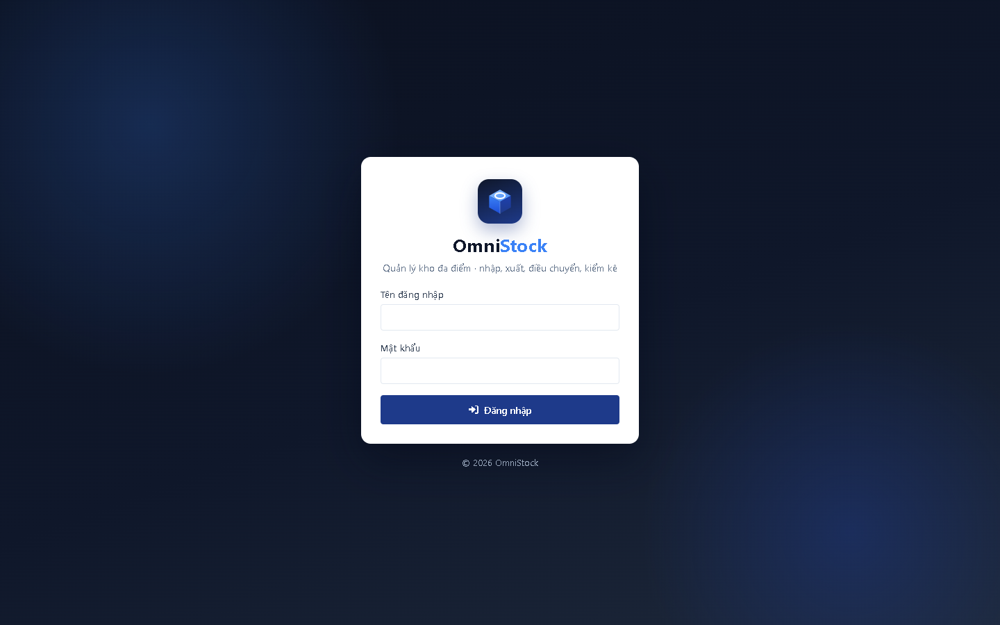

### Tổng quan (Dashboard)
Số liệu nhanh của các kho được giao, chứng từ gần đây, lô hết hạn / sắp hết hạn và cảnh báo điều chuyển quá hạn.

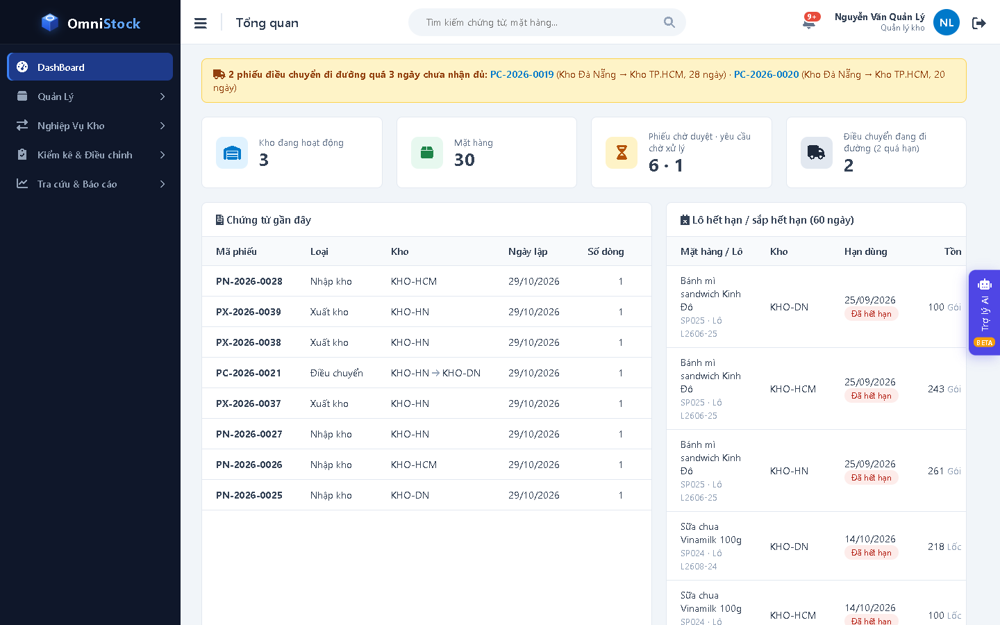

### Danh sách phiếu nhập kho
Lọc theo kho, trạng thái, ngày lập; tìm theo mã phiếu.

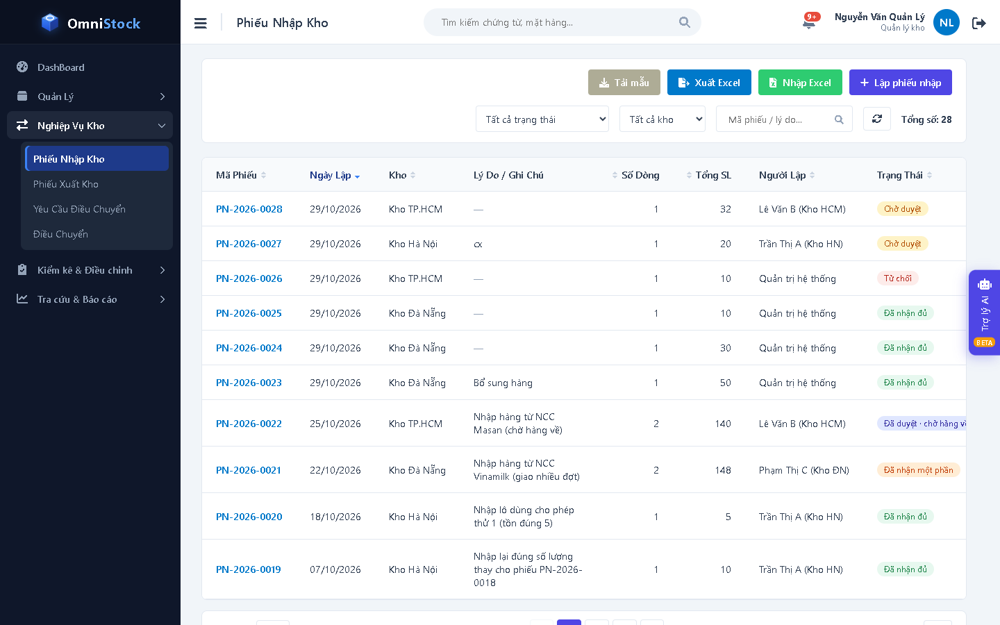

### Chi tiết phiếu điều chuyển
Theo dõi từng bước: lập → duyệt → gửi hàng → hàng đang đi đường → kho đến nhận.

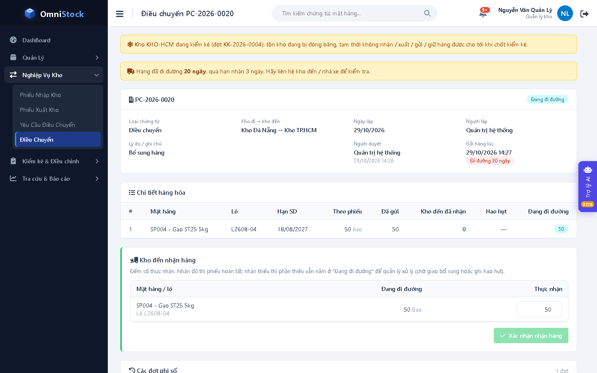

### Yêu cầu điều chuyển giữa các kho
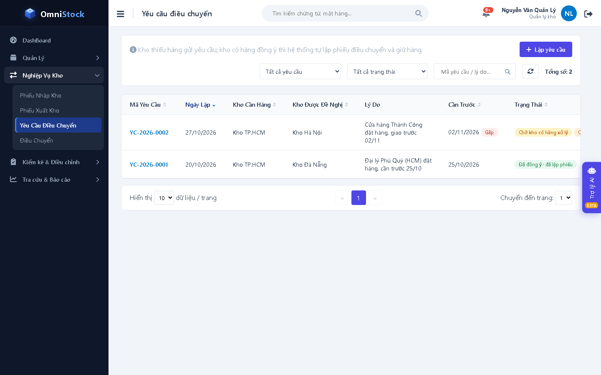

### Kiểm kê nhiều người cùng lúc
Thanh tiến độ, bộ lọc "chỉ dòng chưa đếm"; dòng đang có người nhập sẽ hiện tên người đó và bị khóa với người khác.

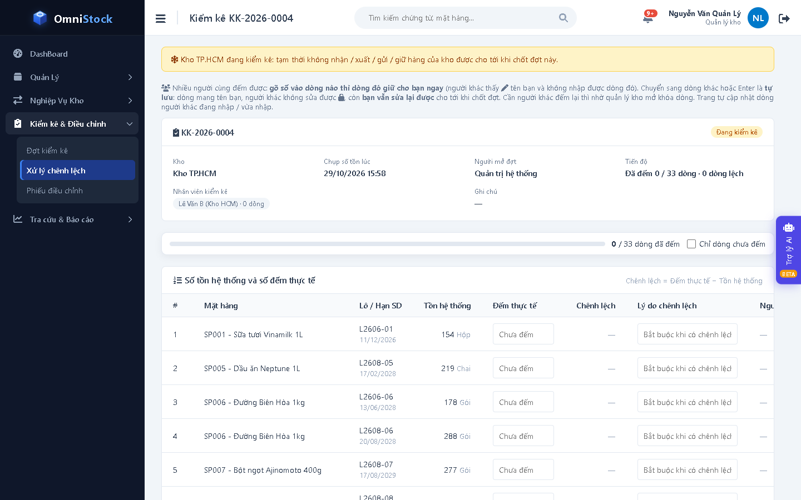

### Báo cáo
| Tồn kho hiện tại | Nhập – xuất – tồn theo kỳ |
|---|---|
| 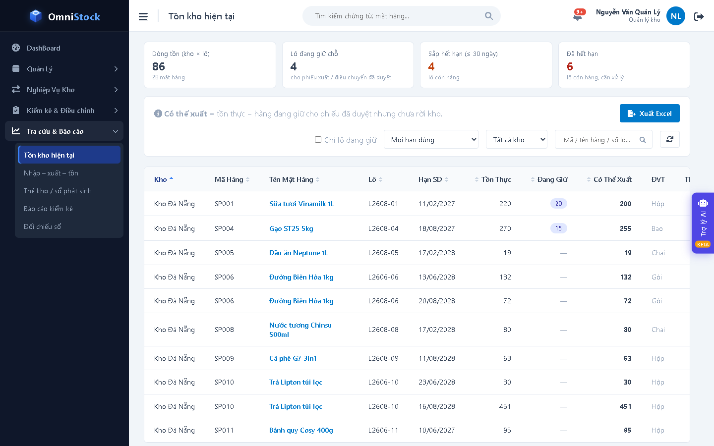 | 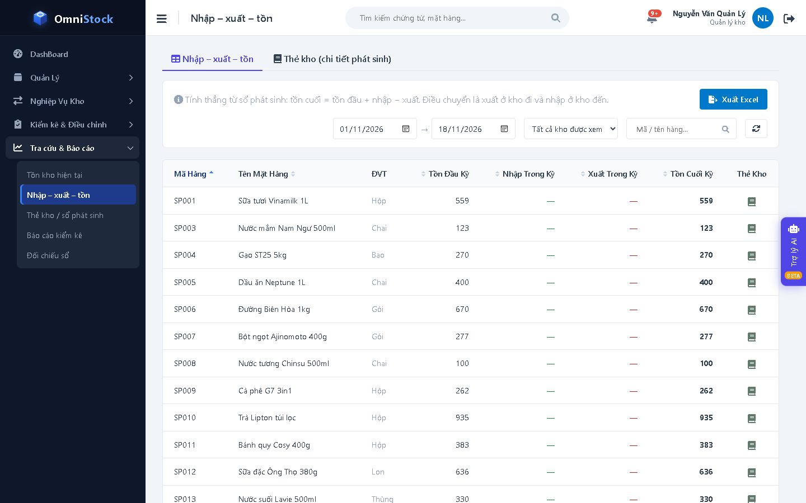 |

**Đối chiếu sổ:** kiểm tra tồn kho có khớp tổng phát sinh, hàng đang giữ chỗ và hàng đang đi đường có khớp chứng từ hay không.

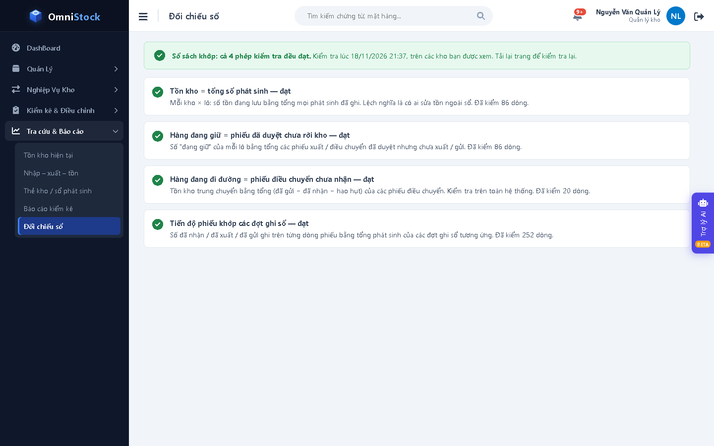

### Thông báo và Trợ lý AI
| Thông báo ở chuông | Trợ lý AI |
|---|---|
| 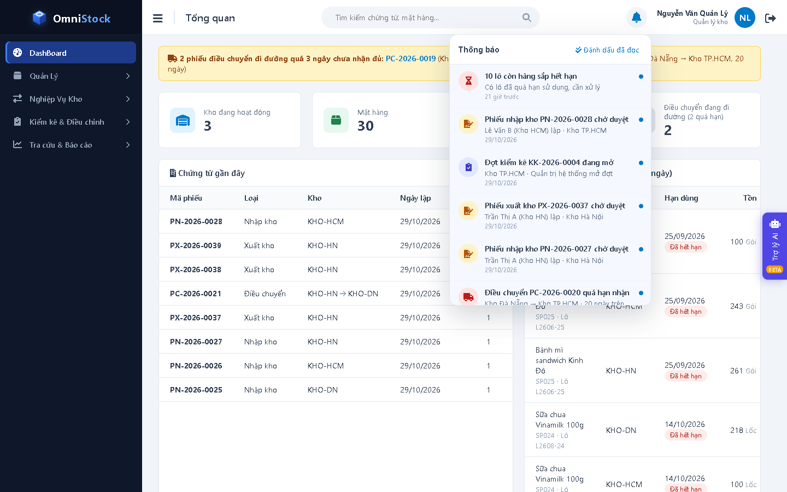 | 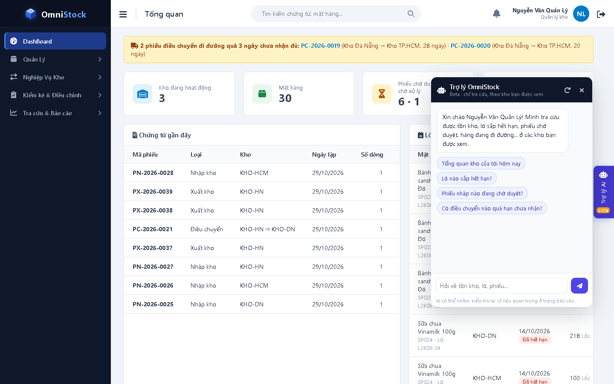 |

### Giao diện điện thoại
<p align="center">
    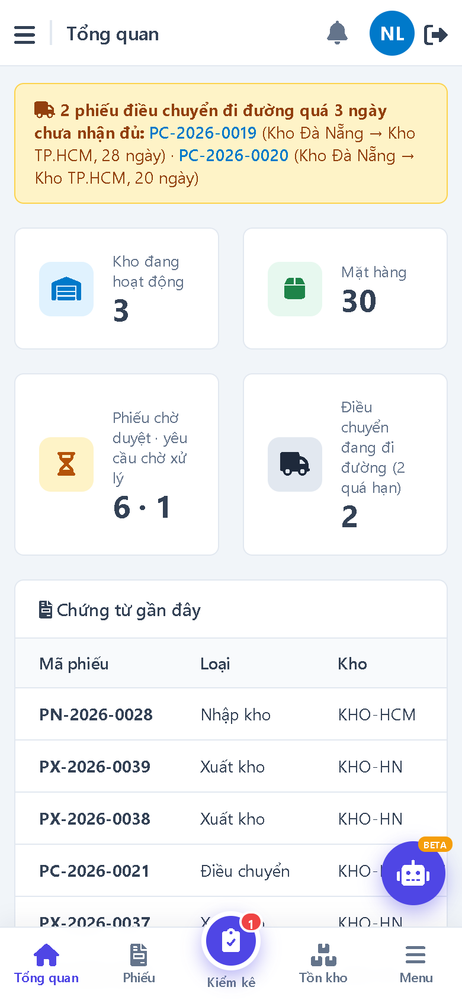
    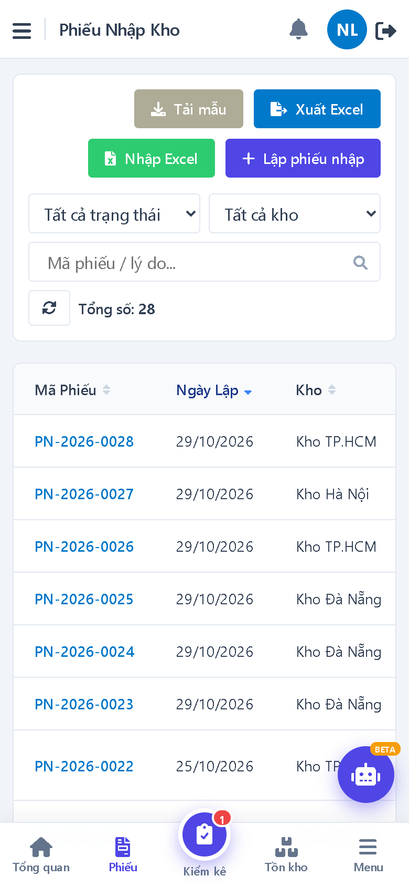
    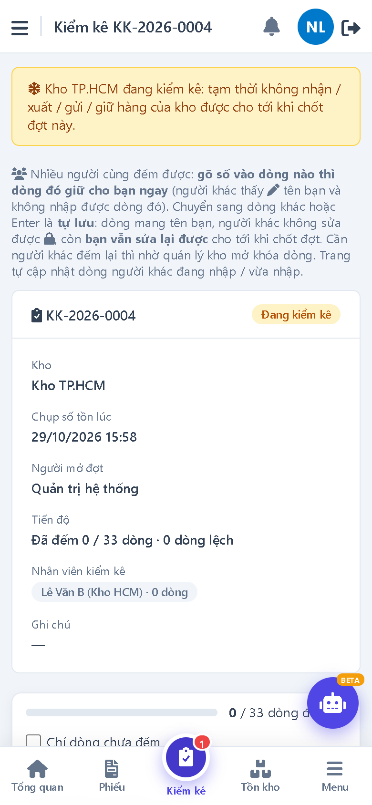
</p>

---

## 4. Hướng dẫn cài đặt

### Dùng thử ngay (không cần cài)
Mở bản demo: <https://omnistock-bf5w.onrender.com>
- Lần mở đầu tiên có thể mất khoảng 1 phút để máy chủ khởi động.
- Dữ liệu demo tự quay về dữ liệu mẫu mỗi khi máy chủ khởi động lại.

### Cài đặt trên máy bằng XAMPP

**Yêu cầu:** [XAMPP](https://www.apachefriends.org) có PHP 8.2 trở lên (đã gồm Apache + MySQL/MariaDB), Git.

**Bước 1. Tải mã nguồn** vào thư mục `htdocs` của XAMPP (đổi `D:\Program\XAMPP` thành thư mục cài XAMPP của bạn):
```powershell
cd D:\Program\XAMPP\htdocs
git clone https://github.com/itzryuka/PTPMNNM-CNTT1809-NHOM10.git StoreManagement
```

**Bước 2. Bật Apache và MySQL** trong XAMPP Control Panel.

**Bước 3. Nạp cơ sở dữ liệu mẫu** (tạo CSDL `quanlykhohang` gồm bảng, trigger và dữ liệu mẫu), chọn một trong hai cách:
- **phpMyAdmin:** mở <http://localhost/phpmyadmin> → **Import** → chọn file `database/quanlykhohang.sql` → **Go**.
- **Dòng lệnh:**
  ```powershell
  cd D:\Program\XAMPP\htdocs\StoreManagement
  D:\Program\XAMPP\mysql\bin\mysql.exe -uroot --default-character-set=utf8mb4 -e "source database/quanlykhohang.sql"
  ```

> ⚠️ Nạp lại file này sẽ **xóa toàn bộ dữ liệu cũ** của CSDL `quanlykhohang` và đưa về dữ liệu mẫu.

**Bước 4. Mở trình duyệt** vào <http://localhost/StoreManagement> và đăng nhập bằng một tài khoản mẫu bên dưới.

Ứng dụng mặc định kết nối MySQL ở `localhost:3306`, tài khoản `root`, không mật khẩu (đúng cấu hình gốc của XAMPP). Nếu máy bạn khác, có thể đặt các biến môi trường `DB_HOST`, `DB_PORT`, `DB_NAME`, `DB_USER`, `DB_PASS`.

**Bước 5 (tùy chọn). Bật Trợ lý AI:**
1. Sao chép `config/ai.example.php` thành `config/ai.local.php`.
2. Lấy API key miễn phí tại <https://aistudio.google.com> → *Get API key*, điền vào `gemini_api_key`.

> File `config/ai.local.php` đã được bỏ qua trong `.gitignore`, **không commit API key lên GitHub**.

### Tài khoản mẫu
Tất cả dùng mật khẩu **`password`**.

| Tên đăng nhập | Vai trò | Kho phụ trách |
|---|---|---|
| `admin` | Quản trị hệ thống | Kho Hà Nội, Kho TP.HCM, Kho Đà Nẵng |
| `quanly` | Quản lý kho | Kho Hà Nội, Kho TP.HCM, Kho Đà Nẵng |
| `nhanvien_a` | Nhân viên kho | Kho Hà Nội |
| `nhanvien_b` | Nhân viên kho | Kho TP.HCM |
| `nhanvien_c` | Nhân viên kho | Kho Đà Nẵng |

> Mật khẩu này công khai, chỉ dùng cho dữ liệu mẫu. Không nhập dữ liệu thật lên bản demo.

---

## 5. Quy tắc nghiệp vụ

### 5.1. Quy trình các loại chứng từ

| Chứng từ | Quy trình | Tồn kho thay đổi khi |
|---|---|---|
| **Phiếu nhập** | Lập → quản lý duyệt → **nhận hàng nhiều đợt** (hàng tốt cộng tồn, hàng hỏng ghi lý do) → nhận đủ thì hoàn tất. Nhà cung cấp giao thiếu thì quản lý đóng phiếu kèm lý do | Mỗi đợt nhận hàng |
| **Phiếu xuất** | Lập → quản lý duyệt (**giữ chỗ** hàng, người khác không xuất trùng được) → **đã xuất kho** hoặc hủy giữ chỗ | Lúc xác nhận đã xuất |
| **Điều chuyển** | Lập → duyệt (giữ chỗ ở kho đi) → **gửi hàng** (hàng chuyển sang trạng thái "đang đi đường") → kho đến **nhận hàng**. Nhận thiếu thì chờ giao bổ sung hoặc ghi hao hụt | Kho đi trừ lúc gửi, kho đến cộng lúc nhận |
| **Yêu cầu điều chuyển** | Kho thiếu hàng gửi yêu cầu → quản lý kho có hàng **đồng ý** (hệ thống tự chọn lô hết hạn trước và lập phiếu điều chuyển) hoặc **từ chối** kèm lý do | Theo phiếu điều chuyển được lập |
| **Phiếu điều chỉnh** | Ghi tăng / giảm tồn, **bắt buộc có lý do**; tự sinh khi chốt kiểm kê | Lúc được ghi sổ |

- Chỉ **quản lý kho / quản trị** của đúng kho đó mới được duyệt hoặc từ chối chứng từ; nhân viên chỉ lập phiếu và thao tác hàng.
- Chứng từ đi **đúng một chiều**: phiếu đã hoàn tất, đã hủy hoặc bị từ chối thì không sửa được nữa.

### 5.2. Kiểm kê
1. Quản lý mở **đợt kiểm kê** cho một kho: hệ thống chụp lại số tồn tại thời điểm mở.
2. Trong lúc kiểm kê, kho bị **tạm khóa** nhập / xuất / gửi hàng để số liệu không bị lệch.
3. Nhiều nhân viên cùng đếm: gõ vào dòng nào thì **giữ dòng đó** (người khác thấy tên và không nhập được); rời dòng hoặc nhấn Enter là **tự lưu**.
4. Dòng có chênh lệch giữa số đếm và số tồn **bắt buộc ghi lý do**.
5. Quản lý **chốt đợt** → hệ thống tự sinh **phiếu điều chỉnh** cho phần chênh lệch và mở khóa kho.

### 5.3. Quy tắc dữ liệu
- **Sổ phát sinh chỉ được thêm, không sửa, không xóa:** muốn sửa sai thì lập phiếu điều chỉnh có lý do, lịch sử luôn được giữ nguyên.
- **Không tồn âm, không giữ chỗ vượt quá số tồn:** kiểm tra ở cả CSDL và khi duyệt / xuất hàng.
- **Một lần ghi sổ là trọn vẹn:** nếu lỗi giữa chừng (ví dụ đã trừ kho A nhưng chưa cộng kho B) thì hoàn tác toàn bộ.
- **Chống tạo trùng phiếu:** bấm Lưu hai lần hoặc tải lại trang không sinh ra hai phiếu.
- **Hàng theo lô:** tồn kho tính riêng từng lô; khi đồng ý yêu cầu điều chuyển, hệ thống ưu tiên **lô hết hạn trước**; lô hết hạn / sắp hết hạn được cảnh báo trên trang tổng quan.
- **Không xóa dữ liệu đã có phát sinh:** kho, mặt hàng đã dùng trong chứng từ chỉ chuyển sang "ngừng dùng" và có thể khôi phục.
- **Phân quyền kiểm tra ở máy chủ:** mọi thao tác đều kiểm tra lại vai trò và quyền kho, không vượt quyền được bằng cách sửa giao diện.

---

## 6. Chức năng mở rộng

Ngoài các yêu cầu chính của đề tài, nhóm làm thêm:

- 🤖 **Trợ lý AI (beta):** hỏi đáp bằng tiếng Việt về tồn kho, lô sắp hết hạn, phiếu chờ duyệt, hàng đang đi đường... AI chỉ được tra cứu (không sửa dữ liệu) và chỉ trên những kho người dùng được xem. Dùng Google Gemini (miễn phí), có thể đổi sang Claude.
- 🔔 **Thông báo ở chuông:** phiếu chờ duyệt, yêu cầu điều chuyển mới, đợt kiểm kê đang mở, điều chuyển quá hạn chưa nhận, phiếu của mình vừa được duyệt / từ chối, lô sắp hết hạn; có đánh dấu đã đọc.
- 📱 **Giao diện điện thoại:** menu dạng ngăn kéo, thanh tab dưới cùng giống ứng dụng, bảng chuyển thành dạng thẻ, trợ lý AI là bong bóng kéo thả được. Nhân viên có thể cầm điện thoại đi đếm hàng khi kiểm kê.
- 📊 **Nhập / xuất file Excel (CSV)** cho danh mục và chứng từ, có file mẫu để tải về.
- 🧾 **Đối chiếu sổ tự động:** phát hiện ngay nếu tồn kho lệch với sổ phát sinh.
- ✅ **Kiểm thử tự động:** hơn 250 phép thử cho các tình huống khó như hai người cùng duyệt khi kho không đủ hàng, lỗi giữa lúc chuyển kho, vượt quyền kho, kiểm kê nhiều người.
- ☁️ **Triển khai online** trên Render bằng Docker, tự cập nhật mỗi khi nhánh `main` thay đổi.

---

## 7. Hướng phát triển

- 📷 **Quét mã vạch / mã QR** bằng camera điện thoại khi nhận hàng, xuất hàng và kiểm kê.
- 🏭 **Quản lý nhà cung cấp và khách hàng**, gắn vào phiếu nhập / phiếu xuất; theo dõi công nợ cơ bản.
- 📉 **Định mức tồn tối thiểu:** tự cảnh báo và gợi ý lập yêu cầu điều chuyển hoặc phiếu nhập khi hàng sắp hết.
- 📈 **Biểu đồ** trên trang tổng quan: xu hướng nhập – xuất, hàng bán chạy, hàng tồn lâu.
- 🖨️ **In phiếu và xuất PDF** chứng từ, biên bản kiểm kê có chữ ký.
- ⚡ **Thông báo tức thời** (không cần tải lại trang) và gửi qua email / Zalo.
- 📶 **Kiểm kê khi mất mạng:** lưu tạm trên điện thoại, có mạng thì tự đồng bộ.
- 🔌 **API** để kết nối với phần mềm bán hàng / kế toán.
- 🤖 Mở rộng **Trợ lý AI**: gợi ý số lượng cần nhập, phát hiện bất thường trong số liệu kho.

<p align="center">© 2026 Nhóm 10 – CNTT 18-09 · Khoa Công nghệ Thông tin – Trường Đại học Đại Nam</p>
